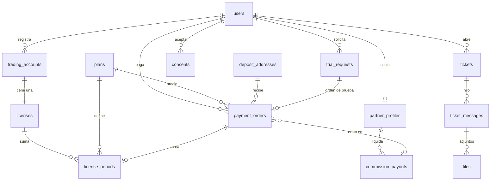
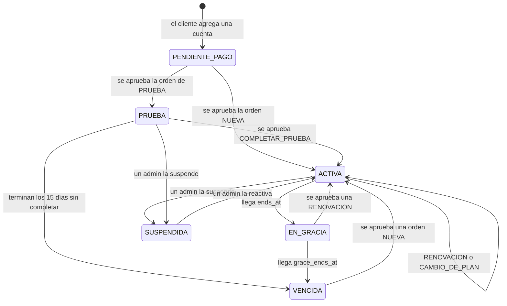
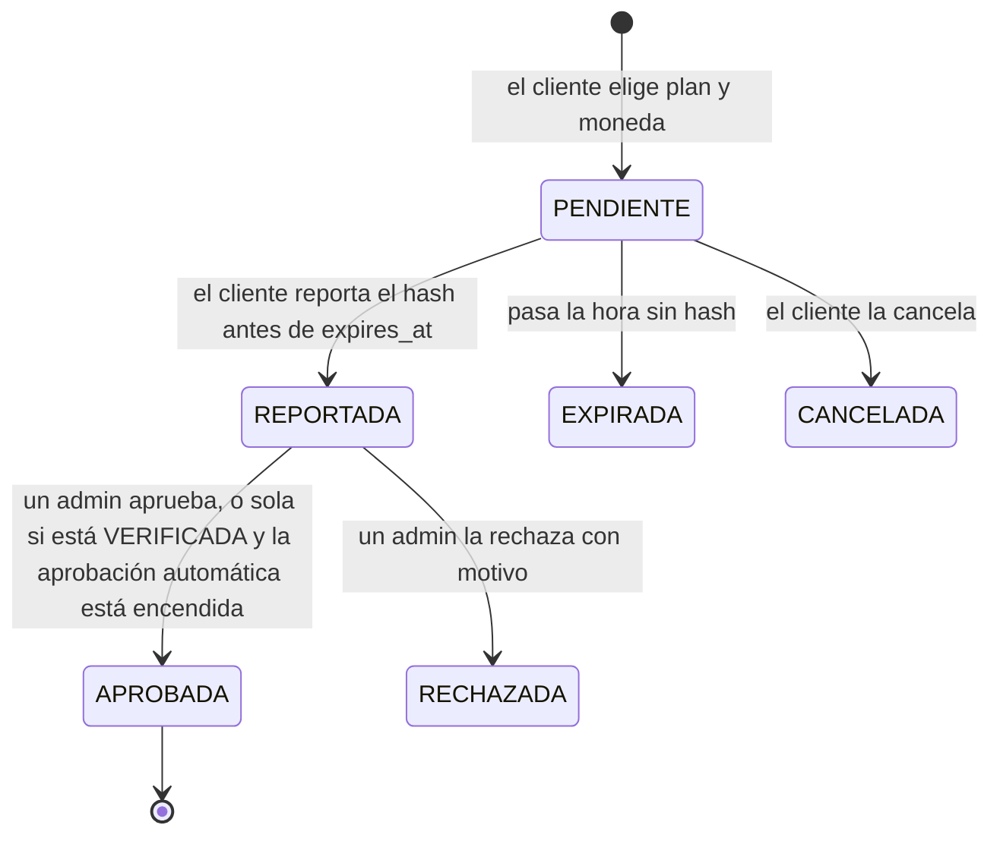
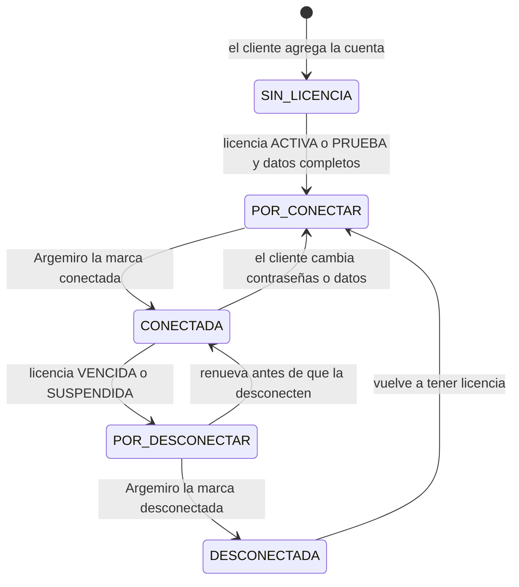
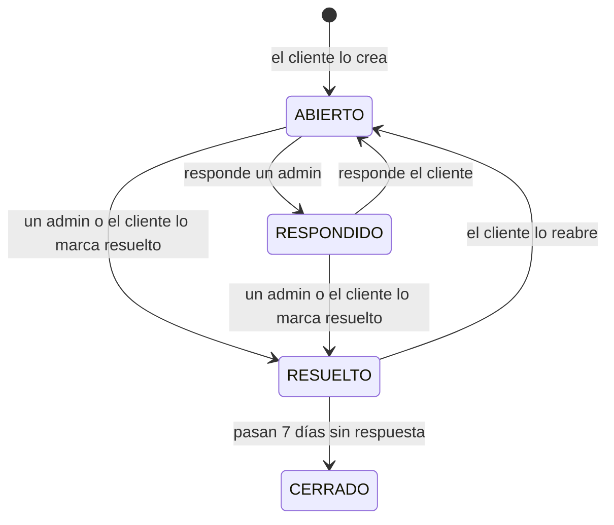

# Modelo de datos y estados

> 2026-10-14. Modelo definitivo para construir con TypeORM sobre PostgreSQL. Reemplaza el borrador de
> `CONTEXTO.md` §6. Las reglas de negocio vienen de `CONTEXTO.md`; la seguridad, de `SEGURIDAD.md`.

## 1. Convenciones

- **Ids:** UUID v7 (ordenables por fecha; los genera la función `uuid_generate_v7()` de la base de datos) en todas las tablas, salvo la auditoría (número consecutivo). Los números
  que ve la gente (orden `DTP-000123`, ticket `1042`) son una columna aparte con su propia secuencia.
- **Fechas:** `timestamptz` en UTC. Se muestran en hora de Colombia (`America/Bogota`). Las duraciones de licencia se
  suman en **meses de calendario** en hora de Colombia: del 3 de octubre, un mes llega al 3 de noviembre; si el día no
  existe (31 de enero + 1 mes), se usa el último día del mes.
- **Dinero:**
  - USD en **centavos** enteros (`integer`): USD 319 = `31900`.
  - Cripto en **unidades base** enteras (`numeric(38,0)`): USDT con 6 decimales (319 USDT = `319000000`) y BTC en
    satoshis (0,00398 BTC = `398000`).
  - Nunca números con decimales flotantes.
- **Porcentajes** en puntos básicos (`integer`): 10 % = `1000`.
- **Cifrado** (AES-256-GCM, ver `SEGURIDAD.md` §4): las columnas `*_enc` guardan `versión de llave + iv + texto
  cifrado + etiqueta`. Las columnas `*_hmac` guardan HMAC-SHA256 para buscar o detectar duplicados sin descifrar.
- **Borrado:** las tablas de clientes usan borrado lógico (`deleted_at`). Los datos personales se borran de verdad
  según los plazos de la política de datos, con trabajos del worker.
- `created_at` y `updated_at` en todas las tablas; se omiten abajo.

## 2. Mapa de tablas

## 3. Tablas

### 3.1. Usuarios y acceso

**`users`**

| Campo | Tipo | Notas |
|---|---|---|
| `role` | enum `ADMIN`, `CLIENT` | |
| `status` | enum `ACTIVE`, `SUSPENDED`, `DELETED` | |
| `full_name` | text | |
| `cedula_enc` | bytea | Cifrada |
| `cedula_hmac` | bytea, **único** | Sobre la cédula solo con dígitos |
| `cedula_last4` | char(4) | Para mostrarla enmascarada |
| `email` | citext, **único** | El que escribió el cliente |
| `email_canonical` | citext, **único** | Minúsculas; en Gmail sin puntos ni lo que va después de "+". Evita dos cuentas con el mismo correo |
| `email_verified_at` | timestamptz | |
| `phone_e164` | text, **único** | Formato internacional (`+573001234567`) |
| `phone_verified_at` | timestamptz | Por SMS (Twilio Verify) |
| `password_hash` | text | Argon2id |
| `totp_secret_enc` | bytea | Cifrado; obligatorio para admins |
| `totp_enabled_at` | timestamptz | |
| `marketing_opt_in` | boolean | Casilla opcional del registro |
| `deleted_at` | timestamptz | |

**`recovery_codes`**: `user_id`, `code_hash`, `used_at`. Diez por usuario con segundo factor.

**`auth_tokens`**: `user_id`, `purpose` (`VERIFY_EMAIL`, `RESET_PASSWORD`, `CHANGE_EMAIL`), `token_hash`,
`expires_at`, `used_at`. De un solo uso.

**`user_devices`**: `user_id`, `device_hash` (identificador del navegador), `user_agent`, `last_ip`, `first_seen_at`,
`last_seen_at`. Sirve para avisar de ingresos desde un dispositivo nuevo. Las sesiones viven en Redis.

**`legal_documents`**: `type` (`TERMS`, `PRIVACY`, `RISK`), `version`, `content_md`, `published_at`, `published_by`.
Las páginas legales se muestran desde aquí. La base de datos no deja cambiar ni borrar una versión publicada: un
cambio es siempre una versión nueva.

**`consents`**: `user_id`, `type` (`TERMS`, `PRIVACY`, `RISK`, `MARKETING`), `legal_document_id` (en la etapa 1 es
`document_version`, el número de versión aceptado, además de `legal_document_id`), `accepted_at`, `ip`,
`user_agent`, `revoked_at`. Es la prueba de la autorización que pide la Ley 1581.

### 3.2. Planes y ajustes

**`plans`**

| Campo | Tipo | Notas |
|---|---|---|
| `code` | enum `MENSUAL`, `TRIMESTRAL`, `SEMESTRAL`, `PRUEBA`, **único** | La trimestral está inactiva desde el 2026-10-15 (se conserva por las órdenes viejas) |
| `name` | text | |
| `duration_months` | integer, nulo en la prueba | 1, 3 o 6 |
| `bonus_months` | integer | 1 en la semestral, 0 en las demás |
| `duration_days` | integer, solo la prueba | 15 |
| `price_usd_cents` | integer | 12000, 49900 y 5000 (la trimestral era 31900) |
| `rank` | integer | Para saber qué plan es "más largo" (1, 2, 3) |
| `is_public` | boolean | La prueba no se compra directo |
| `is_active` | boolean | |

Cambiar un precio no toca las órdenes ya creadas: cada orden copia el precio.

**`settings`**: clave y valor (`jsonb`). Valores iniciales:

| Clave | Valor inicial |
|---|---|
| `grace_days` | 3 |
| `order_ttl_minutes` | 60 |
| `min_confirmations` | `{ "TRON": 20, "BITCOIN": 2 }` |
| `auto_approve_payments` | false |
| `trial.require_verified_contact` | true (no se puede apagar) |
| `trial.require_id_photo` | false |
| `tickets.auto_close_days` | 7 |
| `links` | Telegram, Instagram, broker sugerido |
| `myfxbook` | enlace, número de cuenta y cifras que se muestran |
| `support_email` | support@doctraderpro.com |

Cada cambio de ajustes queda en la auditoría con el valor anterior y el nuevo.

**`faqs`**: `question`, `answer`, `sort`, `is_published`. Las edita Argemiro desde el panel.

**`saved_replies`**: `title`, `body`, `created_by`. Respuestas guardadas de soporte.

### 3.3. Cuentas de trading y licencias

**`trading_accounts`**

| Campo | Tipo | Notas |
|---|---|---|
| `user_id` | uuid | Dueño |
| `holder_name` | text | Titular según el cliente |
| `broker`, `server`, `account_number` | text | Como los escribió el cliente |
| `account_key_hmac` | bytea | HMAC de broker + servidor + número normalizados (minúsculas, sin espacios ni guiones). **Único** entre las cuentas no borradas: una cuenta de trading no puede estar en dos clientes a la vez |
| `account_number_hmac` | bytea | HMAC del número solo, para la señal "mismo número en otro broker" |
| `master_password_enc`, `investor_password_enc` | bytea | Cifradas |
| `passwords_purged_at` | timestamptz | Cuándo se borraron por el plazo de 90 días |
| `connection_status` | enum (ver §4.4) | |
| `connected_at`, `connected_by`, `disconnected_at`, `disconnected_by` | | Quién marcó cada cosa en Social Trader Tools |
| `recommended_capital_usd_cents` | integer | Lo fija Argemiro |
| `risk_level` | enum `BAJO`, `MEDIO`, `ALTO` | Lo fija Argemiro |
| `locked_until` | timestamptz | Durante la prueba no se pueden cambiar broker, servidor ni número |
| `internal_notes` | text | Solo admins |
| `deleted_at` | timestamptz | |

**`licenses`**: una por cuenta de trading.

| Campo | Tipo | Notas |
|---|---|---|
| `trading_account_id` | uuid, **único** | |
| `user_id` | uuid | |
| `plan_id` | uuid | Plan del periodo vigente |
| `status` | enum (ver §4.1) | |
| `is_trial` | boolean | Mientras el periodo vigente sea de prueba |
| `trial_started_at` | timestamptz | Para completar la prueba |
| `starts_at` | timestamptz | Inicio del primer periodo pagado |
| `ends_at` | timestamptz | Fin del periodo vigente |
| `grace_ends_at` | timestamptz | `ends_at` + días de gracia |
| `suspended_at`, `suspended_by`, `suspension_reason` | | |

**`license_periods`**: el historial de lo que se pagó. Cada orden aprobada crea un periodo.

| Campo | Tipo | Notas |
|---|---|---|
| `license_id`, `payment_order_id`, `plan_id` | uuid | |
| `kind` | enum `PRUEBA`, `NUEVA`, `RENOVACION`, `CAMBIO_DE_PLAN`, `COMPLETAR_PRUEBA`, `EXTENSION_ADMIN` | La extensión de días la hace un admin sin pago |
| `period_start`, `period_end` | timestamptz | |
| `bonus_months` | integer | El mes de obsequio, para mostrarlo en verde limón (hoy ningún plan lo trae) |

### 3.4. Pagos

**`deposit_addresses`**

| Campo | Tipo | Notas |
|---|---|---|
| `currency` | enum `USDT`, `BTC` | |
| `network` | enum `TRON`, `BITCOIN` | Se pueden agregar redes después |
| `address` | text | Validada con su checksum |
| `status` | enum `EN_ESPERA`, `ACTIVA`, `INACTIVA`, `CANCELADA` | |
| `activates_at` | timestamptz | Creación + 24 horas (§4.6) |
| `created_by`, `cancelled_by` | uuid | |

Datos iniciales (de la cuenta de Binance de Argemiro), cargados ya activos:
- USDT TRON: `TLNeQNuQ9tsZweb8cvZaghNpJkX3KE7G4x`
- BTC BITCOIN: `1H8xfingRtsTvhnf4PosyhXvacXdGVWea1`

**`payment_orders`**

| Campo | Tipo | Notas |
|---|---|---|
| `number` | text, **único** | `DTP-000123` |
| `user_id`, `trading_account_id`, `license_id`, `plan_id` | uuid | |
| `type` | enum `NUEVA`, `RENOVACION`, `CAMBIO_DE_PLAN`, `PRUEBA`, `COMPLETAR_PRUEBA` | |
| `price_usd_cents` | integer | Precio del plan al crear la orden |
| `credit_usd_cents` | integer | Lo ya pagado que se descuenta: 5000 al completar la prueba |
| `amount_usd_cents` | integer | Lo que se cobra: precio − crédito |
| `currency`, `network` | enum | |
| `deposit_address_id`, `deposit_address` | uuid, text | La dirección se copia: no cambia aunque cambien las del panel |
| `amount_base_units` | numeric(38,0) | Monto exacto en la moneda |
| `btc_usd_rate` | numeric(18,2) | Precio de BTC usado, solo en BTC |
| `expires_at` | timestamptz | Creación + 60 minutos |
| `status` | enum (ver §4.2) | |
| `tx_hash` | text | Lo que reporta el cliente. **Único por red** |
| `reported_at` | timestamptz | |
| `verification_status` | enum (ver §4.2) | |
| `received_base_units` | numeric(38,0) | Lo que llegó |
| `confirmations` | integer | |
| `tx_time`, `block_height` | | |
| `sender_addresses` | jsonb | Billetera(s) de origen, para la señal de la prueba |
| `verification_detail` | jsonb | Los cinco chequeos, con proveedor y fecha |
| `decided_by`, `decided_at` | | Quién aprobó o rechazó |
| `approval_mode` | enum `MANUAL`, `AUTO` | |
| `rejection_reason` | text | Le llega al cliente por correo |
| `commission_bp` | integer | % del socio vigente al aprobar |
| `commission_usd_cents` | integer | `amount_usd_cents × commission_bp / 10000`, redondeado al centavo |
| `commission_payout_id` | uuid | La liquidación que la incluyó |

Venta bruta = `amount_usd_cents` de las órdenes aprobadas (al completar la prueba se cuenta solo la diferencia, porque
los USD 50 ya se contaron con la orden de prueba).

### 3.5. Licencia de prueba

**`trial_requests`**

| Campo | Tipo | Notas |
|---|---|---|
| `user_id`, `trading_account_id` | uuid | |
| `status` | enum (ver §4.3) | |
| `block_reasons` | jsonb | Qué bloqueo saltó: cédula, cuenta, correo o teléfono |
| `signals` | jsonb | Coincidencias encontradas, con la prueba anterior a la que se parecen |
| `device_hash`, `ip` | | De quien envió la solicitud |
| `id_photo_file_id` | uuid | Solo si se pidió la foto |
| `decided_by`, `decided_at`, `decision_note` | | |
| `payment_order_id` | uuid | La orden de USD 50 que se crea al aprobar |

**`trial_registry`**: las huellas que no se borran (ver `CONTEXTO.md`, "Control de la prueba").

| Campo | Tipo | Notas |
|---|---|---|
| `kind` | enum `CEDULA`, `CUENTA`, `CORREO`, `TELEFONO`, `NUMERO_CUENTA`, `DISPOSITIVO`, `BILLETERA` | Los cuatro primeros bloquean; los demás son señales |
| `fingerprint` | bytea | HMAC con `TRIAL_HMAC_KEY` |
| `key_version` | smallint | Para comparar con versiones anteriores de la llave |
| `trial_request_id` | uuid, **sin llave foránea** | Para que sobreviva al borrado del cliente |

Índice por (`kind`, `fingerprint`). Se escribe al **aprobar** una prueba (las de cédula, cuenta, correo y teléfono) y
al verificar su pago (la billetera). La señal de titular parecido se calcula con las pruebas que todavía existen.

### 3.6. Soporte y archivos

**`tickets`**: `number` (consecutivo desde 1000), `user_id`, `topic` (`PAGOS`, `CONEXION`, `LICENCIA`, `TECNICO`,
`OTRO`), `trading_account_id` y `payment_order_id` opcionales, `subject`, `status` (ver §4.5), `priority` (`NORMAL`,
`ALTA`), `assigned_to`, `first_response_at`, `last_client_message_at`, `resolved_at`, `closed_at`.
"Sin responder" no es un estado: es un ticket abierto cuyo último mensaje es del cliente.

**`ticket_messages`**: `ticket_id`, `author_id`, `body` (texto plano), `is_internal` (nota interna que el cliente no
ve).

**`files`**: `owner_user_id`, `purpose` (`TICKET_ADJUNTO`, `FOTO_DOCUMENTO`), `ticket_message_id` (si es adjunto),
`storage_key` (nombre aleatorio en R2), `mime`, `size_bytes`, `sha256`, `is_encrypted`, `delete_after`.

### 3.7. Socio, avisos y auditoría

**`partner_profiles`**: `user_id` (único), `commission_bp` (inicial 1000).

**`commission_rate_changes`**: `partner_id`, `old_bp`, `new_bp`, `changed_by`, `created_at`. Aplica a órdenes
aprobadas después del cambio y avisa a Argemiro.

**`commission_payouts`**: `partner_id`, `period_start`, `period_end` (del 1 al 15, y del 16 al último día del mes),
`gross_usd_cents`, `commission_usd_cents`, `status` (`ABIERTA`, `CERRADA`, `PAGADA`), `paid_at`, `paid_by`,
`payment_reference`.

**`notifications`**: bandeja de salida de correos y SMS.

| Campo | Tipo | Notas |
|---|---|---|
| `user_id` | uuid, nulo en avisos a admins | |
| `channel` | enum `EMAIL`, `SMS` | |
| `recipient` | text | Correo o teléfono al que va |
| `template` | text | `orden-creada`, `vence-7-dias`, … |
| `payload` | jsonb | Datos para la plantilla; nunca contraseñas |
| `secret_enc` | bytea | Enlace de un solo uso del correo, cifrado; se borra al enviarlo |
| `dedupe_key` | text, **único** | Evita duplicados: `vence-7d:{license_id}:{ends_at}` |
| `status` | enum `PENDIENTE`, `ENVIADA`, `FALLIDA` | |
| `attempts`, `next_attempt_at`, `provider_message_id`, `sent_at`, `last_error` | | Hasta 8 intentos con espera creciente |

**`audit_log`**: `id` (bigserial), `actor_id`, `actor_role`, `action` (`payment.approve`, `account.view_passwords`,
`deposit_address.create`, …), `target_type`, `target_id`, `metadata` (jsonb), `ip`, `user_agent`, `created_at`,
`prev_hash`, `hash`. La app solo puede insertar (ver `SEGURIDAD.md` §12).

**Fase 2** (no se crean ahora): `exchange_rates` (TRM del día) para cobrar en pesos.

## 4. Estados

### 4.1. Licencia

- **"Vence pronto"** no es un estado: es una licencia activa con 7 días o menos (para la pantalla y los recordatorios).
- Cómo se calculan las fechas de cada orden aprobada:

| Orden | Inicio del periodo | Fin |
|---|---|---|
| NUEVA | Al aprobar | Inicio + meses del plan + mes de obsequio |
| PRUEBA | Al aprobar | Inicio + 15 días |
| COMPLETAR_PRUEBA | `trial_started_at` | Inicio + meses del plan + obsequio (prueba del 3 oct → semestral hasta el 3 abr) |
| RENOVACION con la licencia activa | `ends_at` actual | Inicio + meses del plan + obsequio |
| RENOVACION en gracia | `ends_at` anterior (los días de gracia cuentan como usados) | Igual |
| CAMBIO_DE_PLAN (a uno más largo) | `ends_at` actual | Igual; la licencia pasa al plan nuevo |

- Solo se pueden crear órdenes de COMPLETAR_PRUEBA mientras la licencia esté en PRUEBA, y de CAMBIO_DE_PLAN hacia un
  plan de `rank` mayor.
- El worker revisa cada 5 minutos las licencias que cambian de estado por fecha.

### 4.2. Orden de pago

`verification_status` avanza por separado mientras la orden está REPORTADA:

| Valor | Qué significa |
|---|---|
| `SIN_VERIFICAR` | Aún no se consulta |
| `ESPERANDO_CONFIRMACIONES` | Todo coincide, faltan confirmaciones; el worker vuelve a mirar |
| `VERIFICADA` | Los cinco chequeos pasaron |
| `MONTO_INCOMPLETO` | Llegó menos de lo pedido |
| `NO_COINCIDE` | Otra dirección, otra moneda, hash ya usado o transacción anterior a la orden |
| `ERROR_PROVEEDOR` | Fallaron los dos proveedores; se reintenta. Nunca se aprueba sola así |

- El hash se debe reportar dentro de la hora; las confirmaciones pueden llegar después.
- Si un pago llega a una orden expirada, soporte lo aplica a una orden nueva al precio vigente.
- Al aprobar, en una sola transacción: se bloquea la orden, se crea el periodo, se actualiza la licencia, se copia el
  % del socio y se encola el correo. Si algo falla, no se aplica nada.

### 4.3. Solicitud de prueba

```mermaid
stateDiagram-v2
  [*] --> BLOQUEADA: cédula, cuenta, correo o teléfono ya tuvieron prueba
  [*] --> PENDIENTE: pasa los bloqueos; se calculan las señales
  PENDIENTE --> APROBADA: un admin la aprueba; se crea la orden de USD 50
  PENDIENTE --> RECHAZADA: un admin la rechaza con motivo
  APROBADA --> [*]
```

Las bloqueadas se guardan para mostrarlas al admin ("bloqueadas este mes"), pero el cliente no puede enviarlas.

### 4.4. Conexión de la cuenta de trading

### 4.5. Ticket

### 4.6. Dirección de depósito

```mermaid
stateDiagram-v2
  [*] --> EN_ESPERA: un admin la agrega con segundo factor; correo a los dos admins
  EN_ESPERA --> ACTIVA: pasan 24 horas
  EN_ESPERA --> CANCELADA: cualquiera de los dos admins la cancela
  ACTIVA --> INACTIVA: un admin la desactiva
  INACTIVA --> ACTIVA: un admin la reactiva (con segundo factor)
```

## 5. Trabajos del worker

| Trabajo | Frecuencia | Qué hace |
|---|---|---|
| Expirar órdenes | Cada minuto | PENDIENTE → EXPIRADA al pasar `expires_at` |
| Verificar pagos | Al reportar el hash y cada 2 minutos mientras esté REPORTADA | Consulta la blockchain y actualiza `verification_status`; aprueba sola si está encendido |
| Estados de licencia | Cada 5 minutos | ACTIVA → EN_GRACIA → VENCIDA, PRUEBA → VENCIDA, y mueve la conexión a POR_DESCONECTAR |
| Recordatorios | Cada hora | 7, 3 y 1 día antes, el día del vencimiento y para completar la prueba; `dedupe_key` evita repetir |
| Activar direcciones | Cada minuto | EN_ESPERA → ACTIVA al pasar `activates_at` |
| Cerrar tickets | Cada hora | RESUELTO → CERRADO a los 7 días |
| Liquidar comisión | Días 15 y último del mes | Cierra el periodo y suma las órdenes aprobadas |
| Enviar avisos | Continuo | Envía `notifications` pendientes con reintentos |
| Borrar datos vencidos | Diario | Contraseñas de trading, fotos, tickets y registros según la política de datos |
| Copia de seguridad extra | Semanal | Copia cifrada de la base de datos en R2 |

## 6. Reglas confirmadas (2026-10-14)

1. **Renovar durante la gracia:** los días se suman desde el vencimiento anterior, así que los días de gracia
   cuentan como usados. Si se suman desde el día del pago, la gracia sería tiempo gratis.
2. **La prueba no tiene gracia:** al terminar los 15 días sin completarla, la cuenta pasa a "por desconectar".
3. **Una cuenta de trading solo puede estar en un cliente a la vez.**
4. **Si el cliente cambia la contraseña o los datos de una cuenta conectada**, vuelve a "por conectar" para que
   Argemiro la actualice en Social Trader Tools.
5. **Suspender no congela los días:** la licencia sigue corriendo mientras está suspendida.

## 7. Cómo quedó construido (etapa 3, 2026-10-15)

- **Restricciones en la base de datos** (además de las reglas en la API):
  - `trading_accounts_cuenta_vigente`: índice único sobre `account_key_hmac` entre las cuentas no borradas.
  - `payment_orders_una_abierta`: una sola orden PENDIENTE o REPORTADA por licencia.
  - `payment_orders_hash_por_red`: índice único (`network`, `tx_hash`).
  - Una licencia PENDIENTE_PAGO no tiene fechas ni plan; con un periodo aprobado, siempre las tiene.
  - Todo periodo sale de una orden, salvo `EXTENSION_ADMIN`.
- **Huellas:** `account_key_hmac` y `account_number_hmac` usan `LOOKUP_HMAC_KEY` (la de buscar sin descifrar). Las
  huellas del registro de pruebas (`trial_registry`, etapa 6) usarán su propia `TRIAL_HMAC_KEY`.
- **Tipo de orden:** lo decide la API con el estado de la licencia (`tipoDeOrden` en `packages/shared`): sin pagar o
  vencida es NUEVA; activa o en gracia, a un plan de `rank` mayor es CAMBIO_DE_PLAN y al mismo o a uno menor,
  RENOVACION (renovar a un plan más corto queda por confirmar con Argemiro, ver `PENDIENTES.md`).
- **Orden abierta:** crear otra orden para la misma licencia cancela la PENDIENTE (el cliente cambió de plan o de
  moneda); si hay una REPORTADA, no se puede crear otra hasta que se revise.
- **Montos:** USDT = centavos × 10.000. BTC = centavos × 10⁸ ÷ precio en centavos, redondeado hacia arriba (el
  cliente nunca queda debiendo un satoshi). El precio se guarda en `btc_usd_rate` y vale para toda la orden.
- **Dirección:** la orden toma la dirección ACTIVA más reciente de la red (`activates_at` ya cumplido) y la copia.
- **Expiración:** el worker pasa a EXPIRADA las PENDIENTE vencidas cada minuto; mientras tanto, la API ya las muestra
  como expiradas y no acepta su hash.
- **Quitar una cuenta:** solo con la licencia sin pagar o vencida, sin conexión (o ya desconectada) y sin pago
  reportado. Es un borrado lógico y las contraseñas se borran en el acto.

## 8. Cómo quedó construido (etapa 4, 2026-10-15)

- **`verification_detail`** guarda `{ proveedor, revisadaEn, chequeos: [{ clave, estado, texto }], nota, error }`.
  `clave` es `HASH`, `DESTINO`, `MONTO`, `FECHA` o `CONFIRMACIONES`; `estado`, `OK`, `FALLA` o `ESPERA`.
- **Qué estados se vuelven a mirar:** `SIN_VERIFICAR`, `ESPERANDO_CONFIRMACIONES` y `ERROR_PROVEEDOR` (cada 30 s).
  `MONTO_INCOMPLETO` y `NO_COINCIDE` no cambian con el tiempo: los decide el admin. Si los proveedores fallan, el
  estado anterior se conserva y solo se anota el error.
- **Chequeo de la fecha:** la hora del bloque debe ser posterior a la creación de la orden, con 2 minutos de
  tolerancia por diferencia de relojes. Un pago de Bitcoin sin confirmar espera ese chequeo.
- **Aprobar:** `VERIFICADA` se aprueba directo; los demás estados piden `forzar` ("aprobar de todos modos") y queda
  anotado en la auditoría. La aprobación automática solo aprueba `VERIFICADA` y se registra con el actor `SYSTEM`.
- **Comisión:** se copia el `commission_bp` del perfil de socio al aprobar y `commission_usd_cents` =
  `amount_usd_cents × bp / 10000`, redondeado al centavo.
- **Conexión al pagar:** `SIN_LICENCIA` y `DESCONECTADA` pasan a `POR_CONECTAR`; `POR_DESCONECTAR` vuelve a
  `CONECTADA` (renovó a tiempo); las demás se quedan como están.
- **Vencimiento por fecha:** `ACTIVA` → `EN_GRACIA` al pasar `ends_at`; `EN_GRACIA` → `VENCIDA` al pasar
  `grace_ends_at`. Al vencer: `CONECTADA` → `POR_DESCONECTAR` y `POR_CONECTAR` → `SIN_LICENCIA`. La licencia en
  prueba y la suspendida se manejan en las etapas 5 y 6.
